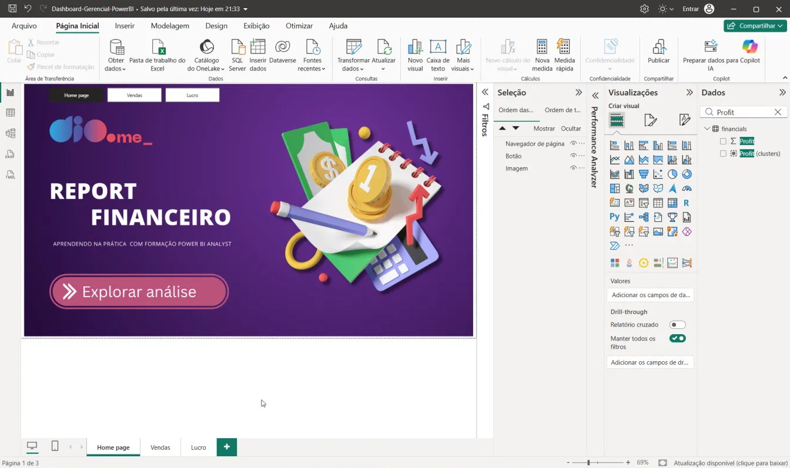
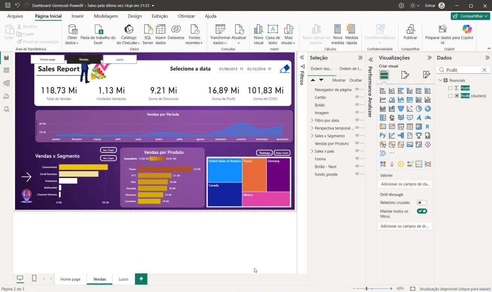
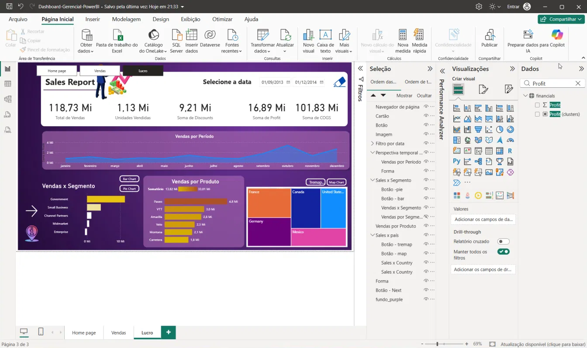

# Dashboard Gerencial para Tomada de Decisões com Power BI

Relatório financeiro com foco na experiência de uso: três páginas, navegação em todas elas e duas leituras distintas — volume de vendas e lucro.

## Objetivo

Atualizar o relatório criativo de vendas para apoiar a decisão. O layout segue posicionamento, contraste, proporção (faixa principal mais larga que os detalhes) e segmentação dos dados. O arquivo de entrega é `Dashboard-Gerencial-PowerBI.pbix`. Os dois arquivos originais da pasta não foram alterados.

## Como abrir

1. Abra o Power BI Desktop.
2. Arquivo → Abrir → `Dashboard-Gerencial-PowerBI.pbix`.
3. Use os botões **Home page**, **Vendas** e **Lucro** no topo de cada página. A página atual fica preenchida; as outras ficam só com o contorno.

## Páginas

| Página | O que mostra |
| --- | --- |
| Home page | Capa do relatório e o botão **Explorar análise**. |
| Vendas | Filtro de data, indicadores e a leitura de volume: vendas por período, por segmento, por produto e por país. |
| Lucro | A mesma composição da página de Vendas, com os gráficos em **Soma de Profit**: evolução do lucro no período, lucro por segmento, por produto e por país. |

### Home page

### Vendas

A página de volume mantém o eixo de período na casa dos 20 Mi, os produtos na casa dos 30 Mi (Paseo à frente) e o treemap de países liderado pelos Estados Unidos.

### Lucro

Na página de lucro, sem filtro cruzado, os números do período completo são:

- Indicadores: 118,73 Mi de vendas, 1,13 Mi de unidades, 9,21 Mi de descontos, **16,89 Mi de lucro** e 101,83 Mi de COGS.
- Período: área de lucro entre 0 e 4 Mi, de janeiro a dezembro.
- Segmento: Government à frente, eixo até 10 Mi.
- Produto: Paseo 4,8 Mi, VTT 3,0 Mi, Amarilla 2,8 Mi, Velo 2,3 Mi, Montana 2,1 Mi, Carretera 1,8 Mi.
- País (treemap): France, Canada, United States, Germany e Mexico proporcionais ao lucro.

## Decisões de experiência

- Menu de navegação em todas as páginas. O botão da página atual fica preenchido em preto com texto branco; os demais ficam em branco com texto escuro. Isso cobre destacar, focalizar e selecionar.
- O menu fica no topo do relatório, sobre a ilustração, para não cobrir o filtro de data, os indicadores nem o último produto da lista.
- Vendas e Lucro dividem a decisão: uma página lê o volume, a outra lê onde o lucro se concentra. O contraste de escala (20 Mi contra 4 Mi no período) deixa essa diferença visível sem trocar o layout.
- Números em milhões (Mi), fonte Segoe UI e cantos arredondados, no tema azul e roxo já existente no relatório.
- Os botões Bar Chart / Pie Chart e Tremap / Map Chart continuam alternando o gráfico de segmento e o de país.
- O quarto indicador, que repetia descontos, passou a mostrar o lucro.
